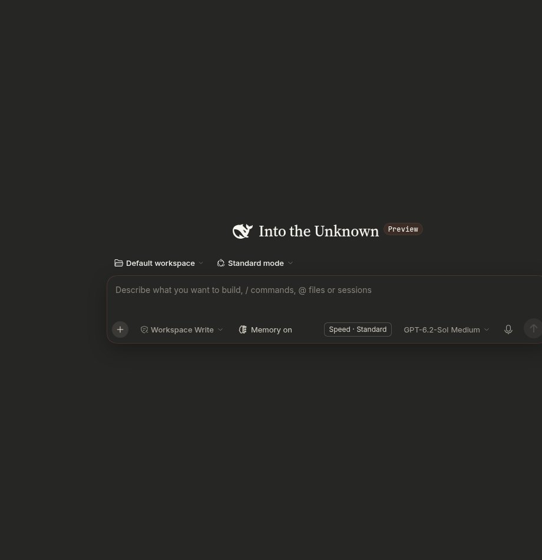
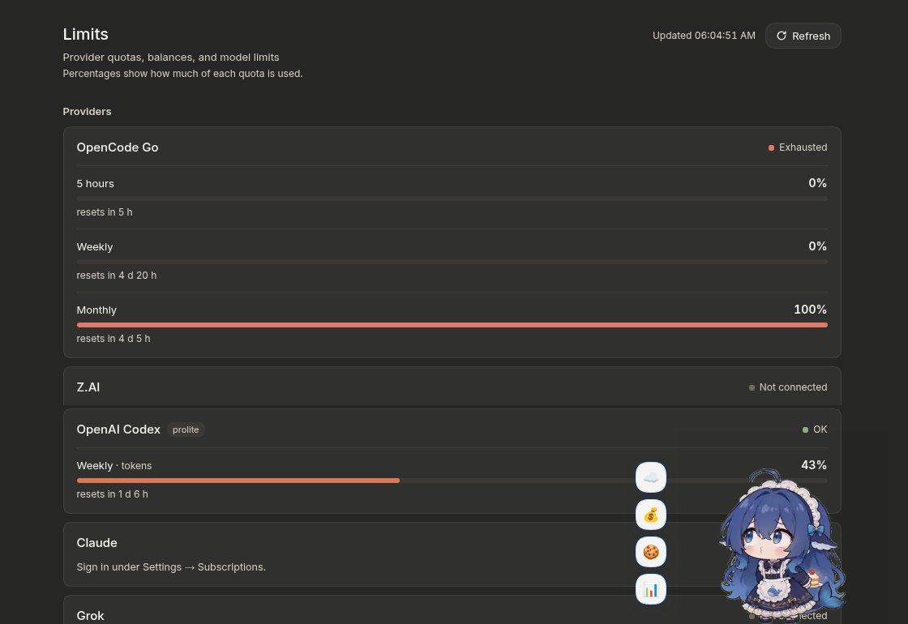
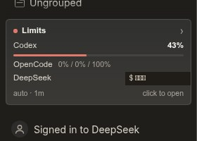
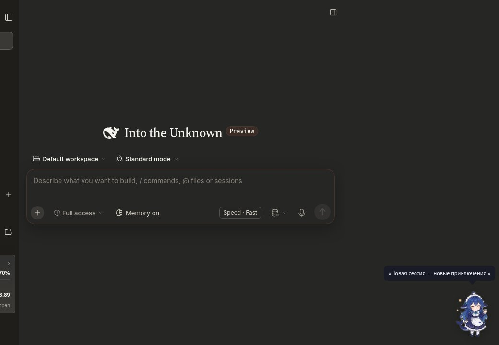
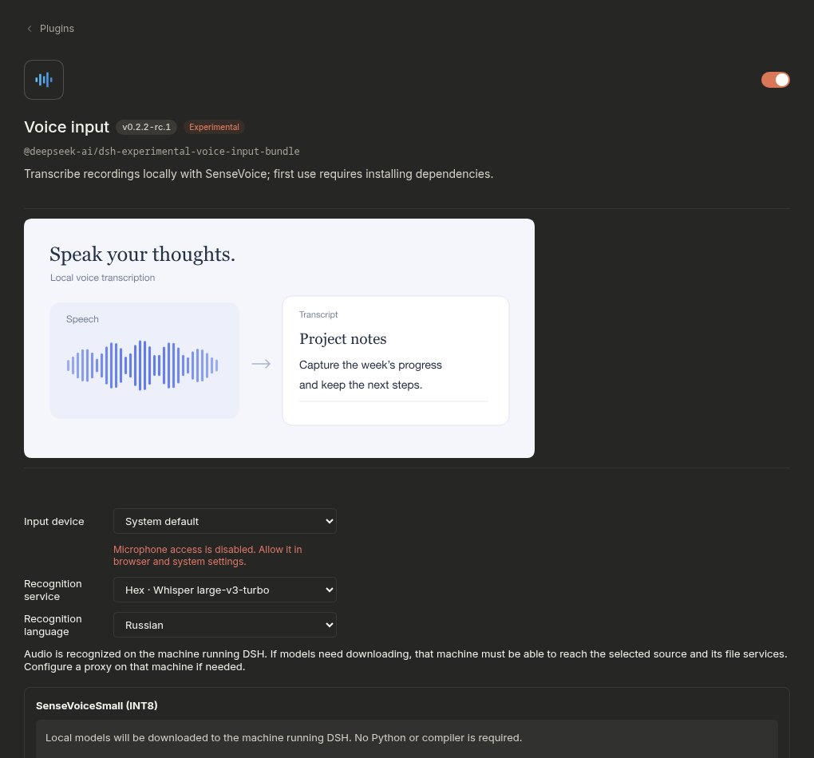
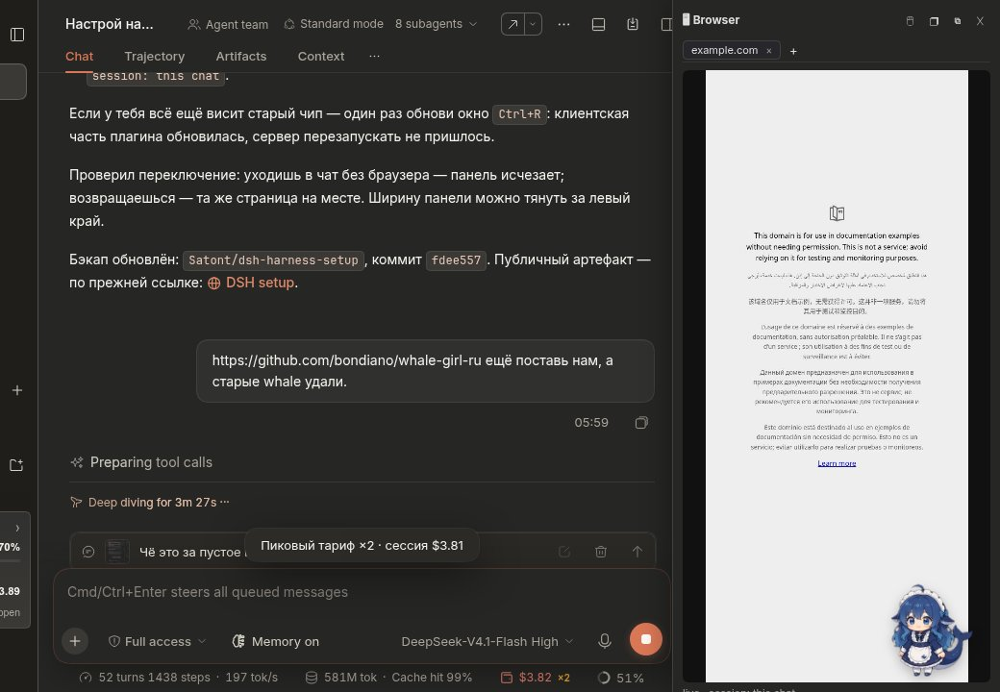
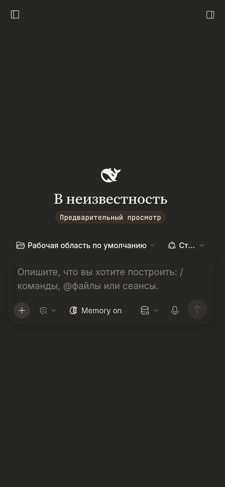

# DSH Harness Setup

A reproducible backup of a DeepSeek Harness (DSH) "Claude Code Desktop" style setup:
warm dark UI, GPT/Codex and other subscriptions as models, a visible agent browser
(any model can open, click and read pages while you watch inside DSH), project threads,
memory, artifacts with public sharing, session/worktree lifecycle, project skills and MCP,
and a phone-friendly HTTPS route through a small VPS.

This repository is a **template + runbook**, not a copy of the private DSH home.
No credentials, OAuth tokens, API keys, passwords or private account identifiers are
stored here. See [SECRETS.md](SECRETS.md) and [.env.example](.env.example).

## Status this backup was taken from

- DSH runtime: `0.2.2-rc.1` (web profile)
- OS: Linux (Arch), Wayland, Node.js 26.x
- Profile: `~/.dsh/profiles/web`
- UI: `dsh-claude-ui` (local CSS/client plugin)
- Main model: Codex subscription route `codex`, default `GPT-6.2-Sol`, medium effort
- Extra UI: `dsh-better-sidebar@0.32.0`, `dsh-context@0.85.1`,
  `dsh-plugin@2.3.9` (Plugin Hub), `@local/dsh-usage-limits` (Limits panel),
  `dsh-limits-strip` (local sidebar card), `whale-girl` Russian pet
- Voice: `dsh-voice-hex` with local Hex **Whisper large-v3-turbo**, default language `ru`
- Browser: local `dsh-agent-browser` fork in `plugins/agent-browser` — `browser_*` tools for
  every model + live viewport docked in the right sidebar; per-chat page context; managed
  Chrome via `agent-browser install`
- Subagents: model selection enabled for new Sessions; Kimi K3/K3.1 Pro route
  (`kimi-coding`) plus the default DeepSeek route
- Extras: `impeccable` skill installed globally under `~/.dsh/skills/impeccable`

## What is in the repository

| Path | Purpose |
|---|---|
| `AGENTS.md` | Instructions for the next agent: how to restore safely, what never to commit |
| `RESTORE.md` | Step-by-step restore, verification, and failure recovery |
| `profile/` | Profile manifests: `package.json`, `cordis.patch.yml`, pnpm settings |
| `plugins/` | Local plugin source: theme, inline bash, worktrees, limits card, patched agent browser |
| `ops/` | Desktop wrapper, mobile/VPS helpers, artifact sharing script, systemd units |
| `docs/` | Architecture, plugin inventory, VPS/mobile runbook, operations, secrets |
| `scripts/restore-profile.sh` | Build a fresh profile from this repo (backs up existing manifests) |
| `tools/model-tuning/` | Context-window and compaction tuning generator |

## Screenshots



| Limits page | Sidebar card |
|---|---|
|  |  |

| Whale-girl (RU) | Voice Input (Hex) |
|---|---|
|  |  |

| Agent browser (live, docked) | |
|---|---|
|  | Model opened and clicked a real page; the viewport is docked in the right sidebar. |



Screenshots are sanitized: balances and account identifiers are hidden, and the sidebar is
cropped where session names would appear. See `docs/screenshots/README.md`.

## Quick restore

```bash
git clone <this-repo> dsh-harness-setup
cd dsh-harness-setup
./scripts/restore-profile.sh web      # DSH_HOME defaults to ~/.dsh
dsh --profile web
```

Then open **Settings → Subscriptions** and sign in to ChatGPT/Codex (and optionally
Claude / Grok / Copilot / Antigravity). Sign-in tokens are stored outside this repo,
under `~/.dsh/plugins/subscriptions/auth.json`, never in git.

For the full procedure, including the VPS relay and the phone route, read
[RESTORE.md](RESTORE.md) and [docs/MOBILE-VPS.md](docs/MOBILE-VPS.md).

## Security model

- The repo contains **no live secrets**. Placeholders in `.env.example` must be filled
  locally or in a password manager.
- Public mobile access is HTTPS on your own VPS, protected by Traefik + Let's Encrypt
  and a Basic-Auth relay in front of the DSH launch-token/cookie flow. The home DSH
  server is not exposed directly.
- Public artifact pages are static snapshots served with a sandbox CSP; they do not
  receive DSH cookies or same-origin access.
- Do not commit `~/.dsh/.credentials.yaml`, `~/.dsh/plugins/subscriptions/auth.json`,
  `~/.config/dsh-mobile/vps.conf`, `dsh-mobile` runtime auth files, `.env`, SSH keys,
  or any token-bearing URL.

## License

Original scripts and documentation in this repository are MIT-licensed. Third-party
plugins under `plugins/` keep their own licenses and notices; see the files in each
plugin directory and `NOTICE` where present.
